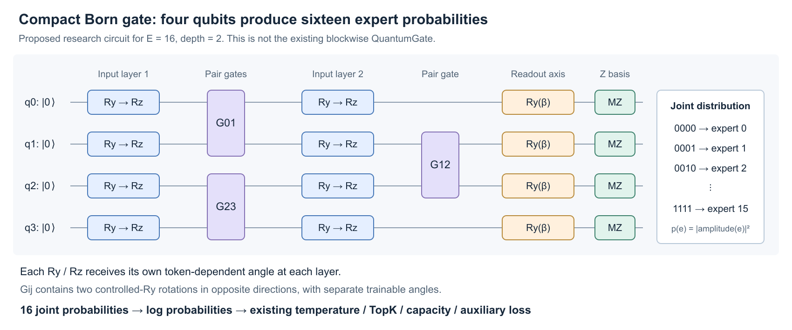

# MoTE / MiXT gate：量子与 TN 候选设计

这是研究原型与本机成本检查，不是语言模型效果报告。四个候选均实现 logits 接口并通过 TopKGate 的反传测试，但没有注册到生产配置、HF 导出和训练恢复流程。现有 `gate_arch="quantum"` 仍然指向原双比特分块版本。

## 建议先验证的两条路线

1. **量子线路：CompactBornGate。** q=ceil(log2(E)) 个量子比特，联合计算基概率对应专家。E=16/64 时仅需 4/6 qubit，状态只有 16/64 个复振幅。两层 Ry/Rz 数据重上传、可训练双向 CRY、联合 Born 读出。它更直接适合有限数量专家的分类路由。
2. **经典 TN：ResidualMPSGate。** 16 个压缩特征、bond dimension 8 的归一化矩阵乘积特征，接 E 维输出。它不强制幺正性，用于检验真正有用的是多体乘性特征还是量子约束。当前本机成本明显低于连通 E-qubit 原型。

BrickwallConeGate 保留每专家一个 qubit 的解释，作为局部相互作用对照；SweepDensityGate 是严格可收缩的阶梯线路，但当前实现有串行开销和远程敏感度衰减，不作为第一优先项。所谓“优先”基于接口、可计算性、成本与可验证性，尚未证明任务准确率更高。

## 1. CompactBornGate：小寄存器与联合测量



令 q=ceil(log2(E))，L=2，r=16：

    u = W_in h                       # d -> r
    a = pi * tanh(W_angle u)          # r -> 2 L q
    a.reshape(L, q, 2)               # 每层每 qubit 各一个 Ry / Rz 输入角

每层先在所有 qubit 上应用 `Ry(a_y + theta_y)`、`Rz(a_z + theta_z)`，再作用一层相邻匹配。第 0 层匹配 (0,1),(2,3),...，第 1 层匹配 (1,2),(3,4),...。每条匹配边使用两次方向相反的 controlled-Ry，参数独立；奇偶层反转先后方向。最后每个 qubit 接一个可训练 Ry(beta)，测量联合计算基概率。

对于 E=16，`0000,0001,...,1111` 分别对应专家 0–15。输出：

    p[e] = |<binary(e)|U(a,theta)|0...0>|^2
    logits[e] = softplus(gain_raw) * log(p[e] + 1e-6)

现有 temperature-softmax、TopK、capacity、STE 和辅助 loss 接收这些 logits。概率来自同一次联合 Z 基读出的比特串分布；不是把 q 个局部 <Z> 值线性扩张为 E 个输出。理想量子概率本身归一化，但平滑、gain、temperature 和 TopK 会继续改变路由分布。

对非二次幂专家数，截取前 E 个结果，再由原 router 归一化；数学上是条件化到有效结果集合。需要额外监控 `valid_mass = full_probs[..., :E].sum(-1)`，不能忽略概率流向未使用结果的情况。近均匀初始化时有效概率质量约为 E/2^q，至少约 1/2。

第 0 层 Ry offset 和最终 Ry readout 各初始化在 pi/4 附近，耦合角初始化 0.05，数据角投影 std=1e-3，使初始分布接近均匀。Rz offset 有小幅非零初始化。末尾 Ry 会将相位信息转换为可测量的概率变化，避免把无作用的末端 Rz 当作表达能力。

**为什么每层重新生成两个输入角？** 如果只生成 q 个输入角，再重复使用，那么 E=16 时可能把输入压成仅 4 个标量。本设计生成 2Lq 个坐标（16 或 24 个），仍通过 r=16 的共同压缩表示。数据重上传是设计动机，不是通用表达能力保证。

**成本：** 当前状态 `2^q < 2E`；逐门计算大致 O(N L q 2^q)=O(N L E log E)，另加编码成本。这里保存完整的小寄存器比引入通用 MPS/SVD 更简单；未来 E 很大时才考虑 TN 替换。不能由此声称量子加速：输出所有 E 个概率本来就需要经典计算，实机还会有采样误差。

**局限：** 联合概率相当于全局投影观测量，不能套用局部 Z readout 的无 barren plateau 结论。当前优势是 q 小。专家到比特串的编号也是归纳偏置，需要固定编号和随机置换对照；可研究依据 MoTE `positions` 的结构编码，但没有理由预设它一定优于随机编号。

## 2. BrickwallConeGate：E 个 qubit 的连通浅线路

复用 rank-16 编码，生成 E 个角；每层 `Ry(s*a+theta)` 后执行交替匹配，匹配中的双向 CRY 单元与上面一致。每个 qubit 读取局部 Z 期望，得到 E 个 logits 特征。

两层后可用连接图贯通整条链，但每个读出的反向因果锥仍最多 4 个 qubit。原型通过反向遍历门列表，删除与该读出无关的门，把同构因果锥打包计算。L<=4 时最多 2L 个 qubit；状态成本依赖浅深度而非 2^E，无 SVD、无截断。复杂度上界约 O(N E poly(L) 2^(2L))，重复因果锥与 Python 小算子有明显常数成本。

一开始用单向 CRY 进行测试时，发现“图有连边”不足以保证两个方向的读出都依赖对方输入。双向单元增加了实际交叉敏感度。测试显式检查 `d z[2]/d a[0] != 0`，它跨越了旧的固定 (0,1)/(2,3) 分块边界。线路连通性与函数依赖需要分别验证。

这是保留“一个专家对应一个局部 qubit”解释时的优先候选，但本机原型比独立分块慢很多。融合算子或更好的共享收缩可能改善成本，目前没有 CUDA 结果。

## 3. SweepDensityGate：无截断的阶梯 TN

每个 qubit 先编码为 Ry(a+theta)|0>。从左到右，每次将当前边界 qubit 与下一个 qubit 通过双向 CRY 作用，旧 qubit 此后不再参与任何门。所有单点读出可以精确递推：

    joint = U (rho_frontier tensor sigma_next) U^dagger
    z_old = Tr[(Ry(beta)^dagger Z Ry(beta) tensor I) joint]
    rho_frontier_next = Tr_old(joint)

只需要一个 2x2 边界密度矩阵和一个 4x4 联合密度矩阵。旧 qubit 的读出先计算，不影响结果，因为后续门只作用于其他 qubit。对应的纯态线路是 bond dimension <=2 的 MPS；没有截断近似，也不构造完整多体态。

原型分别计算左向右和右向左两条**独立线路**，再平均期望值，以减少方向偏置。它是两条线路的经典混合，不是先左扫再右扫同一个量子态；后一种线路不能直接沿用这个 2x2 递推。

代价是按 E 串行循环，而且固定的小记忆不保证远程信息有效保留。`diagnostics.py` 对 E=16、3 个随机输入种子测量输入角到读出的 Jacobian：耦合角 0.2 时，相邻平均敏感度约 0.036–0.047，距离 >=8 的平均敏感度约 1e-12–9e-12；耦合角 1.0 时，远处仍仅约 2e-6–3e-6。它只是这个原型在这些初始化下的局部检查，不是普遍 barren plateau 证明，也不是所有阶梯线路的上限。

## 4. ResidualMPSGate：经典 TN 特征层

压缩得到 m=16 个特征 x_i=tanh((Wh)_i)，定义：

    M_i(x_i) = I + x_i A_i / sqrt(m)
    v(h) = normalize(v_left M_1 ... M_m)
    logits = gain * W_out v(h)

每个 A_i 是 chi×chi 可训练矩阵，默认 chi=8。局部特征基为 (1,x_i)，所以仍是矩阵乘积形式的高阶乘性特征。逐步归一化仅改变标量，在最终方向归一化后与完整矩阵乘积一致（数值 epsilon 附近除外）。它不要求矩阵幺正，也不把输出解释为 Born 概率。

成本约 O(Ndm+Nm chi^2+NE chi)，模型参数约 dm+m chi^2+chi+E chi+1。m 不随 E 增长；但输出 logits 受 chi 维中间表示约束，因此需要比较 chi=8/16。固定 m=16 的串行长度也较短。初始 I+小扰动与归一化用于数值稳定，不构成无梯度消失定理。

这条路线的任务是检验：MoTE gate 是否从乘性高阶特征获益，以及幺正/量子概率约束是否进一步改善效果。不能把所有 TN 模型都称为量子线路。

## 本机验证与成本

`test_candidates.py`：25 项测试通过，涵盖独立 NumPy 稠密量子态对照、范数/概率、输入和参数梯度、跨旧分块依赖、经典矩阵乘积对照、TopK mask/loss 反传、bf16 转换与 state_dict 重载、64 专家宽度检查。

没有真实语言模型训练、CUDA 或硬件执行结果。测试验证的是这些函数实现，不是模型准确率，也不保证所有正式训练环境可直接使用。

CPU、单线程、256 tokens、d=2048、float32（Compact 的内部态为 complex64）、预热 3 次、20 次中位数，完整数据见 `benchmark_cpu.json`：

| Router | E=16 参数 | E=16 forward / ms | E=64 forward / ms | E=16 forward+backward / ms |
| --- | ---: | ---: | ---: | ---: |
| Linear | 32768 | 0.060 | 0.084 | 0.136 |
| MLP r=16 | 33056 | 0.072 | 0.072 | 0.170 |
| 原双比特块 | 33120 | 0.392 | 0.862 | 1.389 |
| 连通砖墙 L=2 | 33135 | 2.884 | 10.120 | 8.956 |
| 双向独立阶梯 | 33149 | 2.539 | 10.025 | 9.208 |
| 经典 MPS m=16,chi=8 | 33929 | 0.233 | 0.235 | 0.896 |
| Compact Born L=2 | 33051 | 0.777 | 1.976 | 2.802 |

这些数值包含不同特征结构与读出，只用于成本筛选；不能称为严格的准确率公平对照，也不能外推 CUDA 排名。原分块在此用 expectation readout；新增量子局部读出、MPS 和 Compact 还包含一个可学习正 gain。正式效果对照应统一校准策略及参数/训练预算。

运行（使用已经有 torch/numpy/pytest 的环境）：

```bash
python -m pytest research/gate_design/test_candidates.py -q
python research/gate_design/benchmark.py --device cpu --output /tmp/gate_benchmark.json
python research/gate_design/diagnostics.py
```

研究阶段可在内存中用候选替换 `TopKGate.router`，`data_dim` 与 `num_experts` 必须来自实际 router，且在创建 optimizer 前替换。现有生产 factory 不会重建这些候选，不能把这样的实验模型直接交给现有训练恢复/HF 导出流程；这需要下一阶段明确注册与版本化配置。

## 优先实验矩阵

先比较参数量接近的 MLP、经典 MPS、Compact Born 和原独立分块；把连通砖墙作为结构对照。固定 backbone、专家数、topk、容量、STE、训练 tokens、更新次数、评测模板和 seeds；初始保持 zloss_coeff=0，单独控制 logit gain/temperature。

Compact 首先做 L=1/2、去除 Rz、纠缠关闭并重训、专家编码随机置换；MPS 比较 chi=4/8/16，另加一个参数量匹配的乘性 MLP/低秩双线性 baseline。不要只与 linear 比，否则不能隔离量子或 TN 结构的价值。

记录任务质量、恢复损失、真实训练吞吐/显存、TopK margin、softmax 前后熵、drop rate、H_batch-H_tok、同词不同上下文路由、专家 positions 条件分布，以及 coupling/输入投影的梯度。随机打乱 token-route 对应关系但尽量保持负载，检验匹配是否有用。若未来引入 TN 截断，再测截断误差与 TopK 翻转率。

建议先使用固定拓扑和全局共享可训练耦合，避免一步引入完整 hypernetwork 的参数和归因混淆；若确实需要逐 token 可变耦合，可再试低秩小幅调制 gamma_e(h)=gamma_e^0+c*tanh(v_e^T u)，并与相同预算的经典调制网络对照。

## 调研来源与适用范围

- [Stoudenmire & Schwab, 2016/2017](https://arxiv.org/abs/1605.05775)：MPS/Tensor Train 用作监督学习函数，支持经典 TN 路线；不直接验证 MoTE gate。
- [Huggins 等, 2018/2019](https://arxiv.org/abs/1803.11537)：树与 MPS 的量子机器学习线路，以及经典训练/量子实现的联系；本原型并非逐字复现该文。
- [Hou 等, 2023](https://arxiv.org/abs/2305.12856)：顺序线路与固定 bond dimension MPS 的联系；其可表达任意固定 bond MPS 的结论不能直接套到这里只含两次 CRY 的受限单元。
- [Pérez-Salinas 等](https://arxiv.org/abs/1907.02085)、[Schuld 等](https://arxiv.org/abs/2008.08605)、[Barthe & Pérez-Salinas](https://arxiv.org/abs/2311.10822)：输入重上传、频率结构与梯度；不自动保证本模型通用或更优。
- [Liu 等, PRL 2022](https://arxiv.org/abs/2108.08312)：TN 的训练性依赖 cost 与观测量，使用 TN 不等于自动消除 barren plateau。
- [QMoE, 2025](https://arxiv.org/abs/2507.05190)：已有量子路由与量子专家研究，实验是小型图像分类；不能据此推出在语言模型中的优势，也不应把“量子 gate”本身作为新颖性声明。

研究价值应落在 MoTE 的结构化专家匹配、可控计算量、稳定训练和严格消融上。本文中的具体候选与优先顺序是结合源码提出的设计判断，不是引用论文已经证明的结论。
